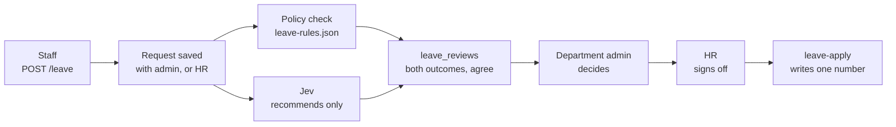
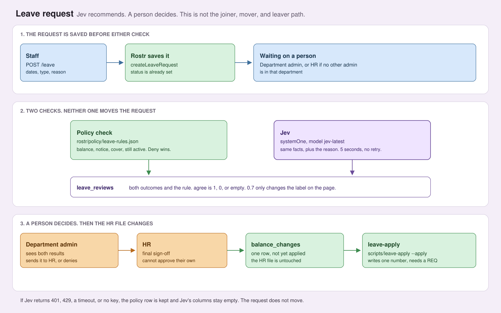
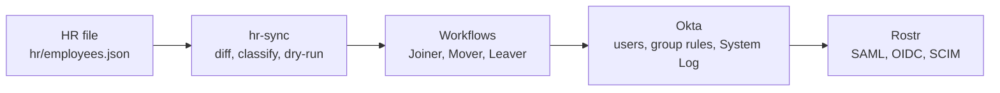
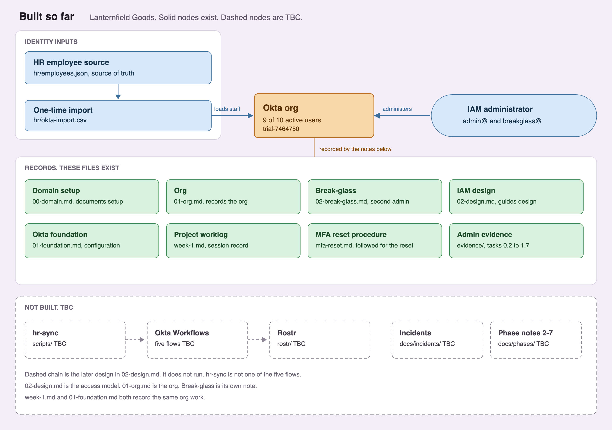

# Okta IAM Lifecycle Lab

A learning lab for Lanternfield Goods, a fictional retailer. The HR source is a JSON file in Git. Okta holds the users, groups, and policies. Rostr is the mock rostering app in `rostr/`. SAML and OIDC sign-in are in place. Okta provisions users and groups into Rostr over SCIM.

The work is day-to-day Okta administration, SaaS onboarding, joiner-mover-leaver automation, and the audit evidence those produce. It is aimed at hands-on Okta practice. About 52 hours over three weeks.

This is a learning lab, not production Okta experience. Every claim points at a file in this repository.

Code is written with AI assistance (Cursor) and reviewed by me. Okta configuration, testing, and the write-ups are done in the org and recorded here.

The domain is `lanternfieldgoods.co.uk`. The org is a 30-day Workforce Identity free trial (`trial-7464750`), not the Integrator Free Plan the design assumed. The 10-user and 5-flow budgets in the design note still apply. Lifecycle Management on this trial ends when the 30 days end.

## Where the project is

The documented lab is done. It took three days, 5 October through 7 October. osTicket ticket `357784` is Closed. The report and the four practice accounts are written for a reader who was not in the lab. The trial org is still up. Teardown was not run.

The second project is the leave hub, inside the same Rostr app. Staff request leave. Jev recommends. A person decides. That path is below. It does not replace joiner, mover, and leaver.

The HR file is ahead of the Phase 4 story. Jonah Hale and Priya Shah are in Operations. Samir Adeyemi and Thomas Okeke are terminated. Marcus Bell and Ava Nguyen were added to `APP-Rostr-Admins` by hand for the stretch below. An orphan row in Rostr was imported, matched nobody, and ignored. The finished account is [docs/report.md](docs/report.md).

## Stretch: leave hub

A staff member signs in to Rostr and asks for leave. [Jev](docs/decisions/jev-02-decision-model.md) recommends approve, deny, or needs review. It does not decide. Code checks the hard rules. A department admin approves first, then HR.

No new Okta user. No new Workflow. The screens use [Kaizen](https://github.com/cultureamp/kaizen-design-system) tokens. [docs/decisions/jev-03-ui-kaizen.md](docs/decisions/jev-03-ui-kaizen.md). The plan is [rostr-leave-jev-report.pdf](rostr-leave-jev-report.pdf). The write-up is [docs/phases/leave-hub.md](docs/phases/leave-hub.md). The clock for this stretch is [docs/worklog/leave-hub.md](docs/worklog/leave-hub.md), not the lab log.

## How a leave request is decided

The request is saved first. The policy check and Jev then both write a recommendation. Neither of them changes the status. The department admin sees both and decides. HR signs off. `leave-apply` is the only writer of the HR file, and it takes a REQ number. The lab diagram further down is a different path.





| Group | Who | What they see |
| --- | --- | --- |
| `APP-Rostr-Users` | Staff already in it by rule | Their own requests |
| `APP-Rostr-Admins` | Marcus Bell, Ava Nguyen | Requests in their department |
| `APP-Rostr-HR` | Helen Cho | Final sign-off for every department |

The phase numbers below are the report's. The cover of that PDF still says only phase 1 is done. The app is further along.

| Phase | Focus | Time box | Status | Where to read it |
| --- | --- | --- | --- | --- |
| 1 | Okta groups and the TypeSafe key | 2 h | Done | [docs/leave/01-okta.md](docs/leave/01-okta.md) |
| 2 | Data model | 3 h | Done | [docs/leave/02-data.md](docs/leave/02-data.md) |
| 3 | UI shell and role routing | 3 h | Done | [docs/leave/03-shell.md](docs/leave/03-shell.md). Sign-in: [docs/incidents/08-rostr-sign-on.md](docs/incidents/08-rostr-sign-on.md) |
| 4 | Staff hub | 3 h | Done | [docs/leave/04-staff.md](docs/leave/04-staff.md) |
| 5 | Policy engine | 4 h | Done | [docs/leave/05-policy.md](docs/leave/05-policy.md) |
| 6 | Jev review | 4 h | Done | [docs/leave/06-jev.md](docs/leave/06-jev.md) |
| 7 | Admin hub | 4 h | Done | [docs/leave/07-queue.md](docs/leave/07-queue.md), [docs/leave/10-grid.md](docs/leave/10-grid.md) |
| 8 | HR hub and write-back | 4 h | Done, except shift rows are not marked released | [docs/leave/08-hr.md](docs/leave/08-hr.md), [docs/leave/09-apply.md](docs/leave/09-apply.md), [docs/leave/11-export.md](docs/leave/11-export.md) |
| 9 | Failure drills | 5 h | Done | [docs/leave/12-drills.md](docs/leave/12-drills.md). [08](docs/incidents/08-jev-talked-into-it.md) through [12](docs/incidents/12-jev-down.md) |
| 10 | Evaluation and write-up | 4 h | Done | [docs/phases/leave-hub.md](docs/phases/leave-hub.md). [evals/results/2026-10-12-leave.md](evals/results/2026-10-12-leave.md) |

Priya, Marcus, and Helen have each signed in and reached their hub. Marcus approved Priya's LV-0002. Helen approved it. REQ-0010 took her annual balance from 2 to 0, and the drill setup put it back to 2. LV-0003 is the first drill: Jev and the policy check both denied. Anything that needs a live Okta sign-in has to land before the trial ends around 4 November 2026.

## Lab

| Phase | Focus | Time box | Status | Where to read it |
| --- | --- | --- | --- | --- |
| 0 | Prep, domain, org, and design | 5 h | Done | [docs/decisions](docs/decisions) |
| 1 | Okta foundation | 6 h | Done | [docs/phases/01-foundation.md](docs/phases/01-foundation.md) |
| 2 | SaaS onboarding: SAML and OIDC | 8 h | Done | [docs/phases/02-onboarding.md](docs/phases/02-onboarding.md) |
| 3 | SCIM provisioning | 8 h | Done | [docs/phases/03-scim.md](docs/phases/03-scim.md) |
| 4 | Joiner, mover, and leaver | 7 h | Done | [docs/phases/04-jml.md](docs/phases/04-jml.md) |
| 5 | Governance and audit evidence | 7.5 h | Done | [docs/phases/05-governance.md](docs/phases/05-governance.md). Ticket `357784` is Closed. |
| 6 | Failure drills | 6 h | Done | [docs/incidents/02-saml-acs.md](docs/incidents/02-saml-acs.md) through [docs/incidents/07-leaver-downstream.md](docs/incidents/07-leaver-downstream.md) |
| 7 | Write-up and teardown | 4 h | Done | [docs/report.md](docs/report.md) and [docs/interview-stories.md](docs/interview-stories.md). The org was not torn down. |

## Data flow

An HR change is the only manual step on this path. Okta and Rostr follow. Access Request joins at Okta from a ticket. Stale-Access is a script. It reads Rostr and the HR file and does not sit on this arrow.





Every node is built. The top row is the path above. `hr/okta-import.csv` was the one-time load. `hr-sync` is a script, not one of the Workflows. Teardown is not on this diagram. Leave requests are not on it either. That diagram is [above](#how-a-leave-request-is-decided).

## Run Rostr locally

Docker is required. From `rostr/`:

```bash
docker compose up -d --build
```

Do not pass `-v`. That deletes the database volume. `http://127.0.0.1:3000/health` returns the text `OK`.

`rostr/.env` is not in Git. Compose refuses to start without these names set: `SESSION_SECRET`, `OIDC_ISSUER`, `OIDC_CLIENT_ID`, `OIDC_CLIENT_SECRET`, `SCIM_TOKEN`. `OKTA_SAML_METADATA_URL` and `ROSTR_BASE_URL` are also read. `ROSTR_BASE_URL` defaults to `https://rostr.lanternfieldgoods.co.uk`. Copy the names from [.env.example](.env.example) for the scripts; the Rostr process reads `rostr/.env`, not the root file.

The public hostname needs the tunnel. Credentials and `config.yml` stay in `~/.cloudflared/`. The tunnel name is `rostr`. It sends `rostr.lanternfieldgoods.co.uk` to `http://localhost:3000`.

```bash
cloudflared tunnel run rostr
```

`npm test` in `rostr/` runs the unit tests. It does not need the tunnel.

## Read it in order

Each numbered file links to the one before it. The decisions use this order, including the two files numbered 02.

1. [docs/decisions/00-domain.md](docs/decisions/00-domain.md)
2. [docs/decisions/01-org.md](docs/decisions/01-org.md)
3. [docs/decisions/02-break-glass.md](docs/decisions/02-break-glass.md)
4. [docs/decisions/02-design.md](docs/decisions/02-design.md)
5. [docs/decisions/scripts-identity.md](docs/decisions/scripts-identity.md)
6. [docs/phases/01-foundation.md](docs/phases/01-foundation.md)
7. [docs/phases/02-onboarding.md](docs/phases/02-onboarding.md)
8. [docs/phases/03-scim.md](docs/phases/03-scim.md)
9. [docs/phases/04-jml.md](docs/phases/04-jml.md)
10. [docs/phases/05-governance.md](docs/phases/05-governance.md)
11. [docs/decisions/oig-mapping.md](docs/decisions/oig-mapping.md)
12. [docs/incidents/00-duplicate-rostr-admin.md](docs/incidents/00-duplicate-rostr-admin.md) through [docs/incidents/08-rostr-sign-on.md](docs/incidents/08-rostr-sign-on.md)
13. [docs/report.md](docs/report.md)
14. [docs/interview-stories.md](docs/interview-stories.md)
15. [docs/phases/leave-hub.md](docs/phases/leave-hub.md)

## What is in place

- Domain and catch-all mail: [docs/decisions/00-domain.md](docs/decisions/00-domain.md).
- Org, daily admin, and break-glass: [docs/decisions/01-org.md](docs/decisions/01-org.md), [docs/decisions/02-break-glass.md](docs/decisions/02-break-glass.md).
- User budget, five flows, and naming: [docs/decisions/02-design.md](docs/decisions/02-design.md).
- Seven staff, group rules, session policies, help desk role, MFA reset, and the Entra-to-Okta names: [docs/phases/01-foundation.md](docs/phases/01-foundation.md).
- Lost-phone reset: [docs/runbooks/mfa-reset.md](docs/runbooks/mfa-reset.md).
- SaaS onboarding: [docs/runbooks/saas-onboarding.md](docs/runbooks/saas-onboarding.md).
- Joiner, mover, and leaver: [docs/phases/04-jml.md](docs/phases/04-jml.md).
- Access Request grant and automatic remove, access review, Stale-Access, OAuth review, audit pack, OIG mapping. Ticket `357784` is Closed: [docs/phases/05-governance.md](docs/phases/05-governance.md).
- Six failure drills: [docs/incidents/02-saml-acs.md](docs/incidents/02-saml-acs.md) through [docs/incidents/07-leaver-downstream.md](docs/incidents/07-leaver-downstream.md). A later sign-in failure is [docs/incidents/08-rostr-sign-on.md](docs/incidents/08-rostr-sign-on.md).
- Lab report: [docs/report.md](docs/report.md). The PDF export is [okta-iam-lifecycle-lab-report.pdf](okta-iam-lifecycle-lab-report.pdf).
- Four practice accounts: [docs/interview-stories.md](docs/interview-stories.md).
- Leave hub: staff request, policy check, Jev recommendation, then a person. [docs/phases/leave-hub.md](docs/phases/leave-hub.md). The diagram is [docs/jev-leave.png](docs/jev-leave.png).

## Repository

| Path | Holds | Now |
| --- | --- | --- |
| [docs/decisions](docs/decisions) | Numbered decisions | Domain, org, break-glass, design, service identity, OIG mapping |
| [docs/phases](docs/phases) | One note per phase | Lab [01](docs/phases/01-foundation.md) through [05](docs/phases/05-governance.md). Leave hub: [leave-hub.md](docs/phases/leave-hub.md) |
| [docs/leave](docs/leave) | Leave hub build notes | [01](docs/leave/01-okta.md) through [12](docs/leave/12-drills.md) |
| [evals](evals) | Policy cases and the scored run | [leave-cases.json](evals/leave-cases.json), [2026-10-12-leave.md](evals/results/2026-10-12-leave.md) |
| [docs/runbooks](docs/runbooks) | Repeatable admin steps | [mfa-reset.md](docs/runbooks/mfa-reset.md), [saas-onboarding.md](docs/runbooks/saas-onboarding.md), [oauth-review.md](docs/runbooks/oauth-review.md) |
| [docs/incidents](docs/incidents) | Failure records | [00](docs/incidents/00-duplicate-rostr-admin.md) through [08](docs/incidents/08-rostr-sign-on.md) |
| [docs/worklog](docs/worklog) | Session logs | Lab: [week-1.md](docs/worklog/week-1.md). Leave hub: [leave-hub.md](docs/worklog/leave-hub.md) |
| [evidence](evidence) | Screenshots and log extracts | Tasks 0.2 through 6.6, plus the audit pack |
| [hr](hr) | HR source of truth | [employees.json](hr/employees.json). [okta-import.csv](hr/okta-import.csv) was the one-time load |
| [rostr](rostr) | Mock SaaS app | SAML and OIDC sign-in. SCIM Users and Groups. Leave requests, the policy check, and the Jev recommendation |
| [scripts](scripts) | Test scripts, `hr-sync`, and review exports | [hr-sync](scripts/hr-sync), [leave-apply](scripts/leave-apply), [leave-eval.js](scripts/leave-eval.js), [entitlements.js](scripts/entitlements.js), [access-review](scripts/access-review), [stale-access](scripts/stale-access), [oauth-review](scripts/oauth-review), [audit-log-export.js](scripts/audit-log-export.js) |
| [.env.example](.env.example) | Placeholder names only | No secrets |
